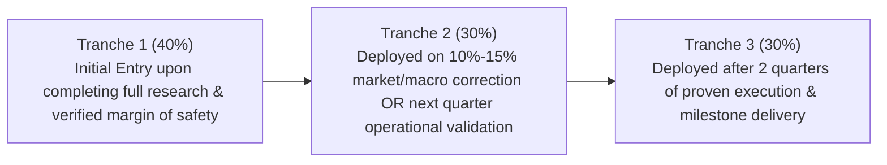
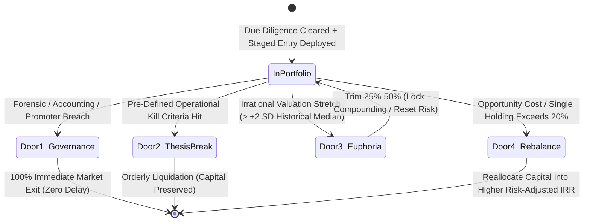

# Indian Equity Investing Rulebook & Capital Allocation Operating System

> **Core Axiom:** An investment is a fractional ownership contract with a real cash-generating enterprise. We do not speculate on quarterly sentiment or tick-by-tick liquidity; we compound capital via multi-year business earnings expansion, reinvestment efficiency, and structural valuation re-rating. In investing, price volatility is merely the liquidity fee of equity markets; the only true risk is the permanent, irrecoverable impairment of capital.

---

## 1. The 10 Non-Negotiable Investing Commandments

| # | Commandment | Operational Rule |
|---|---|---|
| **1** | **Zero Tolerance for Governance Frauds** | Accounting manipulation, related-party siphoning, or promoter dishonesty cannot be offset by "cheap" valuation. A compromised management team triggers an immediate 100% exit on Day 1. |
| **2** | **Pre-Defined Invalidation (The Kill Criteria)** | Every investment thesis must define its falsifiable operational kill metrics *before* committing capital. If the operational thesis breaks, liquidate without debate. |
| **3** | **No Averaging Down Without Re-underwriting** | Never add to a declining position simply because the price is lower. Averaging down requires an explicit, written re-verification that business earning power and moat are completely uncompromised. |
| **4** | **Enforce Capital Allocation Ceilings** | Maximum capital allocated at cost to any single business or industry is strictly capped. Single-stock cost allocation must never exceed the portfolio risk-of-ruin ceiling. |
| **5** | **Cash Flow Reality Over Accounting Accruals** | A business model that cannot convert reported accounting profits into free operating cash over a multi-year cycle is defective. Cumulative cash conversion is non-negotiable. |
| **6** | **Margin of Safety as Priority Zero** | Never buy assuming a flawless future. The entry price must provide a valuation and business cushion against analytical misjudgment, competitive escalation, or macro shocks. |
| **7** | **Independence from Daily Quotations** | Mr. Market is a counterparty offering daily liquidity, not an economic advisor. Daily price fluctuations must never dictate fundamental conviction or trigger reactive decisions. |
| **8** | **Opportunity Cost Discipline** | Capital is finite. An investment that fails to earn its required hurdle rate or whose operational thesis stagnates over a multi-year cycle must be recycled into higher-conviction ideas. |
| **9** | **Resist Premature Trimming of Outliers** | Never sell a compounding business generating superior returns on capital simply because its share price has doubled or "feels high," unless valuation reaches mathematical absurdity. |
| **10** | **Enforce the Execution Buffer (Cooling-Off Rule)** | Zero immediate buy or sell orders during live market hours based on breaking headlines. All investment allocations require an off-market written thesis and a mandatory cooling-off period. |

---

## 2. Investing Infrastructure & Operational Stack

A disciplined long-term strategy fails when the operational environment creates emotional friction, impulsive execution, or behavioral contamination.

```mermaid
flowchart TD
    subgraph Sourcing & Research Stack
        R1["Primary Filings: Annual Reports, Concalls, Credit Ratings"]
        R2["Financial Screening & Forensic Engines (Screener.in / Calculators)"]
        R3["1-Page Investment Thesis & Pre-Execution Ticket"]
    end
    subgraph Execution & Custody Environment
        E1["The Investor Vault (Dedicated Demat, Zero F&O, Zero Margin)"]
        E2["Execution: Cash Delivery Only (CNC), Off-Market AMO / Limit Orders"]
        E3["Tax-Aware Holding Discipline (12-Month LTCG Horizon)"]
    end
    subgraph Monitoring & Maintenance Cadence
        M1["Quarterly Concall & Earnings Audit (May / Aug / Nov / Feb)"]
        M2["Annual Report Deep-Dive (Notes to Accounts & RPT Forensic Audit)"]
        M3["Information Diet: Zero Daily Financial TV / Zero Social Hype"]
    end
    Sourcing & Research Stack --> Execution & Custody Environment --> Monitoring & Maintenance Cadence
```

### A. Account Architecture & Broker Segregation
* **The Dedicated "Investor Vault":** Hold long-term equity investments in a completely separate Demat account from active trading capital. Never mix swing trades and core business holdings in the same account.
* **Delivery-Only (CNC) & Cash Isolation:** The Investor Vault operates strictly on cash delivery (CNC). Intraday margin multipliers (MIS) and derivative segments (F&O) must remain permanently disabled.
* **No Cross-Collateral Pledging:** Holdings in the Investor Vault must **never** be pledged to create margin for active trading or speculative derivatives.
* **Screen Hygiene & Friction:** Do not keep the Investor Vault broker application on your primary mobile home screen. The goal is friction against compulsive portfolio tracking during active market hours.

### B. Primary Information Hierarchy
* **The Golden Source of Truth:**
  1. *Statutory Filings:* Audited Annual Reports (specifically Notes to Accounts, Contingent Liabilities, and Related Party Transactions), Auditor Reports, and Exchange Disclosures.
  2. *Operational Disclosures:* Quarterly Earnings Concall Transcripts, Investor Presentations, and Shareholder Meeting Q&As.
  3. *Independent Forensic Data:* Credit Rating Agency Rationales (CRISIL, ICRA, CARE) and SEBI/Exchange surveillance registries.
* **Banned Information Inputs:**
  * Daily financial news broadcasts and business television tickers.
  * Brokerage "target price" reports and consensus recommendations.
  * Social media tip channels, speculative forums, and anonymous online hype.

### C. Execution Discipline & Timing
* **Off-Market Execution (The AMO Advantage):** Prefer placing After-Market Orders (AMO) or patient Limit Orders outside active market hours. This prevents impulsive buying driven by intraday green candles.
* **Avoid the Morning Volatility Trap:** Never execute investment orders between 9:15 AM and 10:00 AM. Opening order imbalances create artificial spreads and price volatility in mid- and small-caps.
* **Tax-Aware Holding Horizon:** Structure investments with a multi-year horizon. Unless an emergency Governance or Thesis Invalidation trigger occurs, avoid selling winning positions between Month 9 and Month 12 to respect the Indian Long-Term Capital Gains (LTCG at 12.5% vs. STCG at 20%) tax boundary.

---

## 3. Exactly WHEN and HOW to Use Fundamental Analysis

Fundamental analysis is not a predictive crystal ball for next quarter's profit after tax (PAT). It is a **systematic framework to evaluate business economics, capital allocation competence, and price-to-value expectations**.

### The 5-Level Fundamental Quality Funnel

```text
Level 1: Industry Structure & Macro Dynamics  --> What game is being played? (Oligopoly, commodity, fragmented, regulated)
   │
Level 2: Business Engine & Economic Moat     --> Why do customers pay? What protects margins from competitive erosion?
   │
Level 3: Balance Sheet Durability & Solvency --> Can the capital structure withstand a multi-year industry winter?
   │
Level 4: Capital Allocation & Governance     --> How is generated cash deployed? (Reinvestment, M&A, dividends, or siphoning)
   │
Level 5: Valuation & Expectation Inversion  --> What growth and margin profile is the current market price assuming?
```

### Level 1: Industry Structure & Competitive Dynamics
* **Judge the Pond Before the Fish:** A brilliant management team in a structurally terrible, hyper-competitive commodity industry will deliver poor returns on capital.
* **Industry Forces:** Analyze supplier power, buyer concentration, threat of substitutes, and barriers to entry.
* **Regulatory & Technological Risk:** Identify whether the industry is vulnerable to government price controls, sudden duty changes, or technological obsolescence.

### Level 2: Business Engine & Economic Moat
* **Source of Pricing Power:** Can the business raise prices without losing market share to competitors?
* **Moat Classification:** Identify the explicit source of competitive advantage:
  * *High Switching Costs:* Deep integration into enterprise workflows or mission-critical industrial components.
  * *Cost Advantage:* Structural low-cost producer status driven by scale, process, or location.
  * *Network Effects:* Platform value increasing with every incremental user.
  * *Intangibles:* Enforceable patents, regulatory licenses, or dominant brand trust.
* **Moat Direction:** Is the competitive moat widening, stable, or narrowing?

### Level 3: Balance Sheet Durability & Cash Conversion
* **Capital Structure Integrity:** The balance sheet must be capable of surviving an unexpected macroeconomic shock or multi-year industry downcycle without dilutive equity raises or distress.
* **The Cash Conversion Imperative:** Accounting earnings are an opinion; cash flow is a fact. Operating Cash Flow (OCF) must closely track or exceed Operating Profit (EBITDA) over rolling 3- to 5-year periods.
* **Working Capital Behavior:** Monitor whether receivables or inventories are ballooning faster than sales growth.

### Level 4: Capital Allocation & Promoter Forensics
* **The Reinvestment Test:** What return does the company earn on incremental invested capital (ROIC / ROCE)? A company earning high returns on capital that cannot reinvest cash becomes a dividend utility; a company that reinvests at high rates becomes a compounding engine.
* **Capital Distribution:** When internal reinvestment opportunities diminish, does management return cash via dividends and share buybacks, or do they destroy value through unrelated diversifications and vanity M&A?
* **Forensic Alignment:** Promoter equity ownership, pledge levels, audit quality, and clean related-party transactions (RPTs).

### Level 5: Valuation & Reverse Inversion (Expectations Investing)
* **Invert, Always Invert:** Do not start with complex 50-variable DCF forecasts. Start by reverse-engineering the current market price.
* **The Core Inversion Question:** *What multi-year revenue growth, operating margin, and terminal multiple must the company deliver to justify today's valuation at my hurdle rate?*
* **The Margin of Safety:** If the market price requires heroic, unprecedented growth for a decade just to generate a 10% return, there is no margin of safety. Buy when market expectations are conservative relative to business reality.

---

## 4. Exactly WHEN NOT to Rely on Conventional Metrics (The Pitfall Matrix)

Standard financial ratios are historical accounting artifacts. In specific structural conditions, conventional metrics fail predictably and lure investors into value traps or dangerous growth bubbles:

| Scenario / Metric | Why the Metric Fails Here | Mandatory Investor Action |
|---|---|---|
| **1. Low P/E in Cyclical Industries (Metals, Commodities, Bulk Chemicals)** | Earnings peak at the top of the economic cycle, making P/E appear optically dirt-cheap right before margins collapse. | **Do not use P/E.** Evaluate cyclicals using historical Price-to-Book (P/B), enterprise value per unit of capacity, or normalized mid-cycle EV/EBITDA. |
| **2. High ROE Driven by Financial Leverage** | A company can report a 25% ROE by taking on extreme debt with a thin net margin, magnifying equity risk. | **Deconstruct via DuPont Analysis.** Disqualify if ROE expansion is driven by financial leverage rather than asset turnover or operating margin. |
| **3. Low P/B in Asset-Heavy / Obsolete Businesses** | Book value is severely overstated when assets, machinery, or inventory are technologically obsolete or generate returns below the cost of capital. | **Mark assets to economic reality.** Focus on actual net cash generation rather than stated book value. |
| **4. High Dividend Yield in Sunset Industries** | High yields often indicate a collapsing share price in a structurally dying industry. If payout exceeds 100% of Free Cash Flow (FCF), it is financed by debt or asset liquidation. | **Audit FCF coverage.** Disqualify if dividend payments compromise balance sheet solvency or starve necessary business reinvestment. |
| **5. High Revenue Growth with Negative Operating Cash Flow** | Rapid top-line growth fueled by loose credit terms, ballooning trade receivables, or uncollected revenues often masks aggressive accounting. | **Enforce OCF/EBITDA filter.** Demand evidence that cash collections validate reported revenue growth. |
| **6. Apparent Cheapness with Forensic Red Flags** | "Low valuation" often reflects the market pricing in hidden liabilities, promoter pledging, or siphoning through private promoter vehicles. | **Forensics override valuation.** Never buy a governance compromise. A dishonest promoter will ensure minority shareholders never realize the "cheap" value. |
| **7. Single-Customer or Single-Regulation Dependency** | A high-margin, fast-growing company dependent on a single government tender, duty protection, or a single client (>35% revenue) carries binary ruin risk. | **Stress-test for loss of anchor.** Price the business assuming the anchor client or regulatory protection vanishes. |

---

## 5. Capital Allocation Architecture & Position Sizing Framework

Portfolio returns and risk mitigation are driven by capital allocation math, not emotional conviction.

### A. The Conviction & Predictability Sizing Matrix
Position sizing must be governed by two structural axes: **Cash Flow Predictability** and **Balance Sheet Fragility**.

```text
High Cash Flow Predictability
        ▲
        │   Tier 2: Emerging Leaders      Tier 1: Core Compounders
        │   (Mid-Caps / Scalers)          (High-Moat Market Leaders)
        │   Allocation: 4% - 6% at cost   Allocation: 6% - 10% at cost
        │
        ├───────────────────────────────────────────────────────────► Anti-Fragile
        │                                                             Balance Sheet
        │   Tier 4: Disqualified          Tier 3: Asymmetric / Value
        │   (High Leverage / Fragile)     (Cyclicals / Special Situations)
        │   Allocation: ZERO CAPITAL      Allocation: 2% - 4% at cost
        ▼
Low Cash Flow Predictability
```

* **Tier 1 (Core Compounders / High-Moat Leaders):** 6% to 10% of total portfolio capital at cost. Predictable market leaders with durable pricing power, high returns on capital, and clean balance sheets.
* **Tier 2 (Emerging Leaders / Scalers):** 4% to 6% of portfolio capital at cost. High-growth mid-caps expanding market share with sound balance sheets and strong reinvestment runways.
* **Tier 3 (Asymmetric Special Situations / Cyclicals):** 2% to 4% of portfolio capital at cost. Deep value, cyclical turnarounds, or corporate demergers where payoff is asymmetric but outcome variance is higher.
* **Tier 4 (Fragile / Speculative):** Zero capital. Highly levered, governance-questionable, or low-visibility businesses.

### B. Portfolio Guardrails & Concentration Limits
* **Maximum Cost Ceiling:** No single position may ever exceed **10% of total portfolio capital at cost**, regardless of conviction.
* **Maximum Organic Portfolio Weight:** If an exceptional winner compounds organically to exceed **20% of total portfolio value**, initiate a disciplined rebalancing trim back to 15% to manage systemic concentration risk.
* **Maximum Sector Concentration:** Total exposure to any single economic sector must never exceed **25% of total portfolio capital**.
* **Portfolio Breadth Guardrail:** Maintain between **12 and 20 active holdings**. Fewer than 12 creates catastrophic single-event risk; more than 20 causes behavioral neglect, diluted analytical focus, and closet indexation.

### C. Staged Capital Deployment (The Tranche Execution Framework)
Never deploy 100% of an allocation at a single price point on Day 1. Deploy across three disciplined tranches:



* **Tranche 1 (40% of target position):** Initiated immediately upon completing comprehensive due diligence, passing all 8 analytical gates, and confirming valuation provides a margin of safety.
* **Tranche 2 (30% of target position):** Deployed under one of two conditions:
  1. *Price Dislocation:* A broad-market macro panic causes the stock to drop 10%–15% without impacting business fundamentals.
  2. *Operational Confirmation:* The next quarterly earnings report confirms operational execution and thesis tracking.
* **Tranche 3 (30% of target position):** Deployed when the business validates its multi-year trajectory over 2 consecutive quarters (e.g., successful capex commissioning, working capital stability, or new client traction).

### D. Rules for Averaging: Down vs. Up
* **Averaging Down Invariant:**
  * Permitted *only* in the Investor Vault, and *only* when the price decline is caused by macro market panic, broad-sector cyclical sentiment, or transient non-structural disruptions.
  * *Strict Prohibition:* Never average down if the price drop is accompanied by governance concerns, debt defaults, structural market share loss, or margin collapse. Total position must remain strictly under the 10% cost ceiling.
* **Averaging Up (Pyramiding Quality):**
  * Adding to a winning position is encouraged when business intrinsic value compounds faster than the share price (e.g., earnings double while multiple remains stable, or addressable market expands significantly).

---

## 6. Investment Lifecycle Management & The 4 Exit Doors

Investments do not use arbitrary percentage price stop-losses. Instead, capital is protected and recycled through **four objective fundamental exit doors**:



### Door 1: The Governance & Integrity Breach (Immediate 100% Exit)
* **Triggers:**
  * Regulatory investigations (SEBI, ED, SFIO) regarding accounting manipulation or insider trading.
  * Sudden resignation of statutory auditors or CFO without credible operational justification.
  * Discovery of unannounced related-party transactions (RPTs) channeling corporate cash into promoter-owned private entities.
  * Promoter pledging increasing unexpectedly or exceeding internal safety limits.
* **Execution:** Liquidate 100% of the position immediately at prevailing market prices. Do not wait for a dead-cat bounce, earnings calls, or management "clarifications."

### Door 2: Thesis Invalidation / Structural Moat Decay
* **Triggers:**
  * The pre-defined, written operational kill criteria established at entry are breached.
  * Persistent loss of market share to direct competitors over 3 consecutive quarters.
  * Structural margin collapse caused by irreversible loss of pricing power or commoditization.
  * Deterioration of balance sheet health: Debt expanding to fund unviable operational burn, or working capital ballooning uncontrollably.
* **Execution:** Acknowledge the analytical error, exit the position in an orderly manner, and preserve remaining capital. Never alter the thesis to justify holding a failing business.

### Door 3: Valuation Euphoria / Irrecoverable Multiples
* **Triggers:**
  * The market price completely decouples from underlying business fundamentals, discounting 10+ years of uninterrupted future perfection.
  * Valuation multiples (P/E, EV/EBITDA, P/B) trade at extreme statistical deviations ($> +2$ standard deviations above the 10-year historical median) without a structural jump in underlying return on capital.
  * Reverse DCF reveals that the current price assumes growth rates that are mathematically implausible given the industry's total addressable market (TAM).
* **Execution:** Systematically trim **25% to 50%** of the position. Lock in realized capital gains, de-risk the holding, and allow the remaining core to compound while redeploying proceeds into undervalued opportunities.

### Door 4: Opportunity Cost & Portfolio Rebalancing
* **Triggers:**
  * *Concentration Cap Breach:* A winning position organically compounds to exceed **20% of total portfolio value**. Trim back to 15% to maintain portfolio stability.
  * *Superior Hurdle Clearance:* An existing holding's business growth plateaus, offering an estimated forward 3-year IRR below your minimum hurdle rate, while a thoroughly vetted, higher-conviction opportunity is available at a wider margin of safety.
* **Execution:** Prune the lower-yielding holding and reallocate capital into the superior opportunity.

---

## 7. Psychological Firewalls & Adversity Protocols

Behavioral failure during market extremes destroys far more wealth than analytical shortcomings. Enforce these mechanical firewalls:

```text
Macro Market Panic / Severe Drawdown (-15% to -30%)
                     │
                     ▼
       The 48-Hour Cooling-Off Rule
   (Zero market-hours emotional execution)
                     │
                     ▼
          The Holding Audit Gate:
   Did any holding trigger Door 1 (Governance)
       or Door 2 (Operational Break)?
          ├── YES ──► Execute Disciplined Exit
          └── NO  ──► Action is INACTION or Tranche Activation
```

### A. The 48-Hour Cooling-Off Rule
* Never execute an investment purchase or sale during active market hours on the same day a headline breaks, a quarterly result is announced, or an idea is proposed.
* Enforce a mandatory 48-hour pause to review the primary filings in a calm, off-market environment. If an investment thesis cannot survive a 48-hour delay, it is speculative trading, not investing.

### B. Bear Market & Drawdown Protocol
* When broader indices or the portfolio experience severe drawdowns (-15% to -30% from peak):
  1. *Panic Selling Ban:* Selling quality businesses during broad macro panics simply because their prices are falling is strictly forbidden.
  2. *The Fundamental Audit:* Review every portfolio holding against the 4 Exit Doors. If the business earning power, moat, and balance sheet are uncompromised, the drawdown is price volatility, not permanent capital impairment.
  3. *Tranche Activation:* Use macro panics to deploy scheduled Tranche 2 and Tranche 3 capital into Tier 1 Core Compounders at depressed valuations.

### C. The Quarterly Earnings Noise Quarantine
* Stock prices oscillate wildly during quarterly earnings season. A single-quarter earnings miss driven by temporary raw material price spikes, planned maintenance shutdowns, or deferred shipments is operational noise.
* Measure business performance on rolling **3- to 5-year operational horizons**. Never exit a business on a single quarterly result unless it reveals permanent structural decay or governance fraud.

### D. The Zero-Conversion Firewall
* Re-enforce the structural separation between trading and investing: A short-term swing trade that suffers an adverse move **can never be transferred into the Investor Vault** or mentally re-labeled as a "long-term investment." If a trade hits its stop-loss, it is sold in the trading account without exception.

---

## 8. Actionable Operational Checklists

Keep these operational checklists active in your research workspace. Never commit capital without passing every gate.

### Checklist 1: Maintenance Cadence (Quarterly & Annual Review)
- [ ] **Quarterly Earnings Audit (May / Aug / Nov / Feb):**
  - [ ] Are sales, operating profit, and margins tracking within expectations?
  - [ ] Did Operating Cash Flow track reported profit over the trailing 12 months?
  - [ ] Is working capital (receivables/inventory days) stable relative to revenue?
  - [ ] Did management concall commentary remain transparent and grounded?
  - [ ] Did any pre-defined kill criteria get triggered?
- [ ] **Annual Report Forensic Deep-Dive:**
  - [ ] Read the Independent Auditor's Report for qualifications, emphasis of matter, or key audit matters.
  - [ ] Audit Related Party Transactions (RPTs) against revenue and net worth.
  - [ ] Inspect Contingent Liabilities and off-balance sheet guarantees.
  - [ ] Verify promoter shareholding, pledge changes, and insider trading disclosures.

---

### Checklist 2: Pre-Investment 8-Gate Go / No-Go Checklist
*Every investment candidate must clear all 8 gates before initiating Tranche 1:*

| # | Gate | Requirement | Pass? |
|---|---|---|:---:|
| 1 | **Understandability** | Business model and cash generation mechanics can be explained in plain language. | [ ] |
| 2 | **Industry Structure** | Industry is rational, economically viable, and free of fatal regulatory/disruption risks. | [ ] |
| 3 | **Competitive Moat** | Identifiable, durable economic moat (pricing power, low-cost advantage, switching costs). | [ ] |
| 4 | **Balance Sheet Solvency** | Capital structure can survive a 3-year industry downturn without dilution or distress. | [ ] |
| 5 | **Cash Flow Authenticity** | Multi-year Operating Cash Flow (OCF) consistently converts from reported EBITDA. | [ ] |
| 6 | **Governance & Integrity** | Zero unaddressed forensic red flags: clean audit history, no unhedged pledging, clean RPTs. | [ ] |
| 7 | **Margin of Safety** | Current valuation multiple and inverted expectations leave room for analytical error. | [ ] |
| 8 | **Falsifiable Kill Criteria** | Specific, documented operational metrics exist that will trigger a mandatory exit if breached. | [ ] |

---

## 9. Pre-Investment Decision Ticket Template (The 1-Page Thesis)

Copy and fill this standardized ticket into the company's research file before placing any investment order:

```text
===================================================================
PRE-INVESTMENT DECISION TICKET & 1-PAGE THESIS
===================================================================
Ticker & Company Name  : __________________________________________
Date of Thesis         : _____________________
Investment Horizon     : [ ] 3-5 Years   [ ] 5-10+ Years
Target Conviction Tier : [ ] Tier 1 (Core)  [ ] Tier 2 (Scaler)  [ ] Tier 3 (Asymmetric)

1. The Business Engine & Economic Moat:
   - How does this company make cash? _____________________________
   - What is the explicit economic moat? __________________________
   - Why can competitors not replicate this? ______________________

2. Balance Sheet & Cash Conversion Verification:
   - Balance Sheet Strength (Debt / Cash) : _______________________
   - Multi-year OCF to EBITDA Conversion  : ______ % (Must be >= 70%)
   - Working Capital Trend (Stable/Risky) : _______________________

3. Governance & Alignment Audit:
   - Promoter Holding % / Pledge Status  : Holding: ___% | Pledge: ___%
   - Audit Quality & Past Resignations   : _______________________
   - Related Party Transactions (RPTs)   : [ ] CLEAN  [ ] CONCERNING

4. Valuation Inversion & Margin of Safety:
   - Current Valuation Multiples         : P/E: ____ | EV/EBITDA: ____
   - Reverse DCF / Inversion Implied Bar : Needs ___% growth for ___ years
   - Margin of Safety Source             : _______________________

5. Capital Allocation & Tranche Sizing:
   - Target Total Portfolio Allocation   : ____ % of Portfolio at Cost
   - Tranche 1 (40% initial deployment)  : ₹______________________
   - Tranche 2 Trigger Condition         : _______________________
   - Tranche 3 Trigger Condition         : _______________________

6. Pre-Defined Invalidation (Kill Criteria):
   - Kill Metric 1 (Operational/Margin)  : _______________________
   - Kill Metric 2 (Market Share/Growth) : _______________________
   - Governance Red Flag                 : Immediate 100% exit on Day 1

7. Psychological & Behavioral Gate:
   - Was this analyzed off-market with a 48-hr cooling-off pause? [ YES / NO ]
   - Is this an emotional reaction to recent price moves or tips? [ NO / YES ]

FINAL VERDICT: [ ] APPROVED FOR TRANCHE 1     [ ] REJECTED / WATCHLIST ONLY
===================================================================
```

---

## 10. Summary Reference Sheet: The Complete Investing Workflow

```text
PHASE 1: SOURCING & THEMATIC DISCOVERY
1. Screen ideas via systematic operational filters and industry value-chain mapping
2. Filter out companies under surveillance, excessive leverage, or governance ambiguity
3. Group into candidate watchlist for full fundamental underwriting

PHASE 2: 8-GATE COMPREHENSIVE DUE DILIGENCE
1. Analyze industry structure, competitive landscape, and economic moat durability
2. Verify financial ledger: deconstruct ROE via DuPont, verify OCF conversion, inspect working capital
3. Conduct forensic promoter audit: pledging, auditor tenure, related-party transactions
4. Invert valuation: reverse-engineer current market expectations to ensure margin of safety
5. Document pre-defined, falsifiable operational Kill Criteria

PHASE 3: SIZING & TRANCHE EXECUTION
1. Determine conviction tier and enforce maximum portfolio cost ceilings
2. Fill out and save the Pre-Investment Decision Ticket in the company research workspace
3. Enforce 48-hour cooling-off rule
4. Execute Tranche 1 (40%) via patient limit orders outside peak morning volatility

PHASE 4: HOLDING & MAINTENANCE CADENCE
1. Quarantine from daily market quotations, financial TV, and social media commentary
2. Conduct quarterly earnings and concall audits (May, Aug, Nov, Feb)
3. Deep-dive into Annual Reports upon release
4. Deploy Tranche 2 and Tranche 3 strictly upon pre-defined price dislocations or operational proofs

PHASE 5: PRUNING & CAPITAL RECYCLING
- Door 1: Governance/forensic breach   --> 100% immediate market liquidation
- Door 2: Kill criteria / thesis break --> Orderly liquidation (capital preserved)
- Door 3: Valuation euphoria (> +2 SD) --> Systematic trim of 25%-50%
- Door 4: Portfolio concentration/risk --> Prune winners > 20% back to 15% / Reallocate to higher IRR
```
