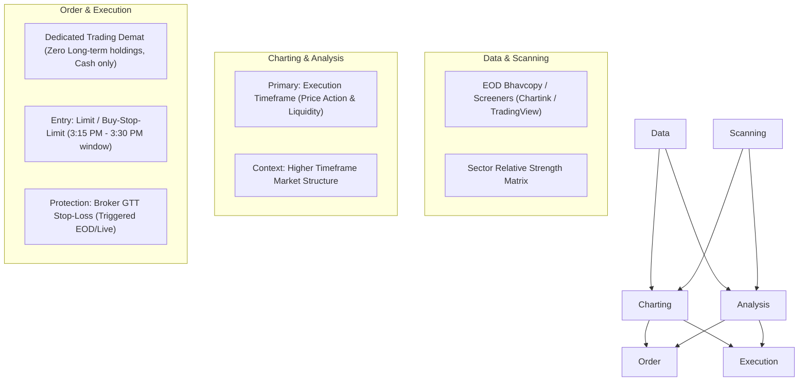
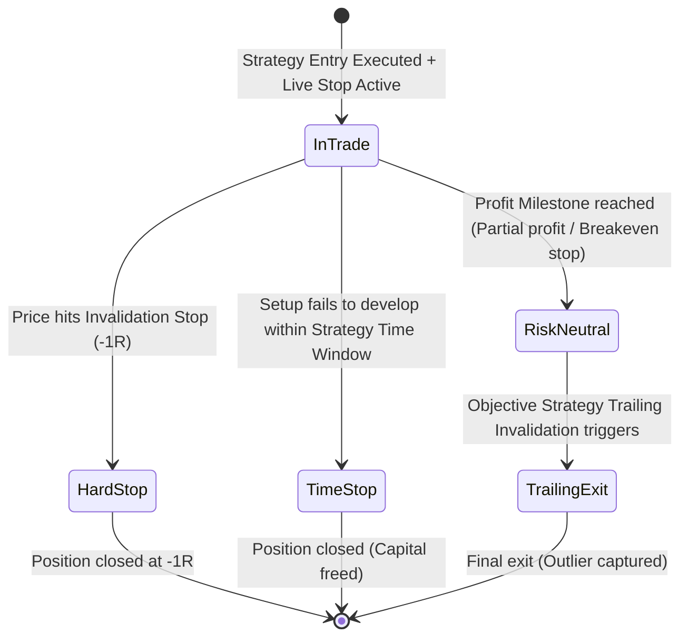

# Indian Equity Trading Rulebook & Operational Operating System

> **Core Axiom:** A trade is a time-bound, mathematical contract with price action and institutional liquidity. It is not an investment, a relationship, or a test of personal conviction. Capital preservation is priority zero; asymmetric upside is the consequence of disciplined execution.

---

## 1. The 10 Non-Negotiable Trading Commandments

| # | Commandment | Operational Rule |
|---|---|---|
| **1** | **Zero Averaging Down** | Never buy more shares of a losing trade. Averaging down on a trade is a capital death sentence. |
| **2** | **The 1R Risk Ceiling** | Max risk on any single trade is strictly **1.0%** of total trading equity. Position size is calculated from stop distance, never arbitrary rupee amounts. |
| **3** | **Pre-Set Invalidation (GTT)** | A Good Till Triggered (GTT) stop-loss order must be active after trade execution. A trade without a live stop-loss is gambling. |
| **4** | **No Trade Without Liquidity** | Minimum 20-day Average Daily Turnover (ADT) must be >= ₹5 Crore and At least 15 of the last 20 sessions must individually clear the ₹2 Crore turnover. Zero trades in 2% circuit bands or stocks under ESM surveillance. |
| **5** | **Earnings & Event Quarantine** | Never initiate a fresh position within **3 trading sessions** before quarterly earnings, Union Budget, or major binary events. |
| **6** | **Market Regime Dictates Sizing** | Trade full size only in a confirmed bullish market regime (healthy benchmark trend and broad market breadth). In neutral regimes, cut risk by half; in confirmed downtrends, hold cash. |
| **7** | **Enforce Objective Time Stops** | If a position fails to develop in your favor within your strategy's predefined time window, liquidate it. Stagnant capital carries massive opportunity cost. |
| **8** | **De-Risk on Profit Milestones** | Once a trade reaches your strategy's predefined reward milestone, systematically eliminate downside risk (adjust stop to breakeven and/or bank partial profits) to make the position risk-free. |
| **9** | **Objective Trend Trailing** | Never exit a winning position because "it feels high." Let winners run and exit strictly via your strategy's predefined, objective trailing invalidation (e.g., dynamic moving average close, structural swing low, or ATR trail). |
| **10** | **Enforce Circuit Breakers** | A -4% monthly account drawdown cuts risk by half. A -8% drawdown triggers a mandatory **1-week trading halt**. |

---

## 2. Trading Infrastructure & Execution Stack

A disciplined strategy fails without an execution environment that eliminates emotional friction and slippage.



### A. Account Architecture & Broker Setup
* **Dedicated Trading Account:** Open a separate trading Demat. Never hold long-term investments in the same account where you execute active trading setups. Mixing them creates psychological contamination and accidental "investing" out of losing trades.
* **Cash Delivery Only (CNC):** For equity trading, trade strictly in the cash/delivery segment. Do not use intraday margin multipliers (MIS) or pledge shares for trade margin. This ensures overnight gap-downs never trigger an automatic margin call liquidation by the broker's risk management system (RMS).
* **Segment Quarantine:** Keep F&O derivatives disabled in this account unless you are running a strictly hedged, dedicated derivatives book.

### B. Order Execution Mechanics
* **Buy Orders — Limit vs. Stop-Limit:**
  * **Never use pure Market Orders** for breakout entries. On Indian mid- and small-caps, market orders cause severe slippage (0.5% - 2.0%).
  * For breakouts: Place a **Buy-Stop-Limit (SL-L)** order with the trigger set at the breakout level and the limit price set 0.3% - 0.5% above the trigger.
  * For pullback / re-test entries: Place a standard **Limit Order** resting at the designated structural support or entry level defined by your strategy.
* **Stop-Loss Orders — GTT / OCO:**
  * Use **Good Till Triggered (GTT)** orders with a dual Stop-Loss + Target (OCO - One Cancels Other) structure.
  * Set the GTT trigger price 0.2% before the actual hard limit price to ensure execution even during fast opening momentum.

### C. Charting Hygiene & Timeframe Integrity
* **Anti-Clutter Mandate:** Indicators are lagging mathematical derivatives of price and volume. Stacking multiple indicators creates analysis paralysis and conflicting signals. Keep the workspace clean: focus on raw price action, market structure, and liquidity.
* **No Ad-Hoc Indicators:** Never add indicators on the fly during market hours to justify an impulse trade. A chart may only display tools explicitly mandated by your written strategy playbook. If an indicator is not in the strategy rules, it is banned from the screen.
* **Timeframe Hierarchy:**
  * **Higher Timeframe (Macro / Weekly):** Governs structural trend, major support/resistance, and institutional capital flow.
  * **Primary Timeframe (Daily):** The execution workspace for setup qualification and mathematical invalidation.
  * **Lower Timeframe (Intraday):** Used solely for execution precision and slippage minimization. Never use lower-timeframe noise to override higher-timeframe market structure.

### D. Systematic Scanning & Screening Discipline
* **Automated Sourcing Mandate:** Trading candidates must originate from objective, algorithmic scans run post-market in a calm environment. Sourcing trades from intraday news spikes, social media tips, or chat groups is strictly forbidden.
* **Mandatory Liquidity & Governance Baseline:** Every screener, regardless of strategy, must first apply universal market hygiene filters:
  * Minimum 20-day Average Daily Turnover (ADT) threshold.
  * Exclusion of stocks under exchange surveillance (ASM / GSM / ESM).
  * Exclusion of stocks with restrictive daily price bands (2% / 5%).
* **Strategy-Defined Triggers:** Specific technical criteria (trend filters, volatility compression, volume expansion, or pullback triggers) are defined strictly within each active strategy playbook.

### E. Screen Time Hygiene & The 3:15 PM Rule
* **The Intraday Churn Trap:** Sitting in front of live tick charts between 10:00 AM and 2:45 PM causes impulsive trading, overtrading, and premature exits on normal intraday oscillations.
* **The 3:15 PM Window:** The institutional close in India occurs between 3:00 PM and 3:30 PM. False breakouts engineered during the morning session (9:15 AM - 10:00 AM) often fade by the close. Evaluating setups and executing orders at **3:15 PM** allows you to see the real daily candle close, confirmed volume, and institutional closing bias.

---

## 3. Exactly WHEN and HOW to Use Technicals

Technicals are not a crystal ball. They are a **probabilistic risk-to-reward calculation and invalidation system**. Technical analysis is never used to predict where a stock will go; it is used to identify high-probability conditions, measure liquidity, and define the exact price where a trade hypothesis is mathematically invalidated.

### The 5-Level Funnel Hierarchy

```text
Level 1: Market Regime Filter       --> Is broad market liquidity & breadth supporting risk?
   │
   ▼
Level 2: Sector Relative Strength   --> Is institutional capital flowing into this specific sector?
   │
   ▼
Level 3: Structural Trend Health    --> Is the stock in an established structural trend with no overhead supply?
   │
   ▼
Level 4: Volatility & Volume Coiling--> Has supply dried up to an asymmetric risk point?
   │
   ▼
Level 5: Trigger & Invalidation     --> Exact strategy trigger candle and mathematical stop-loss anchor.
```

### Level 1: Market Regime Filter (The Gatekeeper)
Never analyze individual setups until the broad market regime is verified.
* **Green Regime (Full Size — 1.0R Risk):**
  * Benchmark indices (Nifty 50, Nifty 500) in confirmed structural uptrends with healthy market breadth (>55% of stocks above medium-term moving average).
  * *Action:* Deploy full 1.0R risk on qualified strategy setups.
* **Yellow Regime (Half Size — 0.5R Risk):**
  * Benchmark index is choppy, range-bound, or breadth is deteriorating (35% - 50% stocks above medium-term moving average).
  * *Action:* Cut risk per trade to 0.5R. Prioritize defensive, lower-volatility setups.
* **Red Regime (Cash / Sit Out — 0R Risk):**
  * Benchmark index in a confirmed downtrend; breadth <35%.
  * *Action:* **Zero fresh long positions.** Close existing trades that break support. Hold 100% cash. Long breakout setups carry an 80%+ failure rate in this regime.

### Level 2: Sector Relative Strength Filter
* Strong stocks in weak sectors fail. Mediocre stocks in leading sectors compound.
* Institutions deploy capital sector-by-sector. Plot the **Sector Index / Benchmark** relative strength ratio line.
* Focus 80% of your prospective watchlist on stocks belonging to sectors demonstrating clear relative strength against the broader market (e.g., sectors making new 3-month or 52-week highs).

### Level 3: Structural Trend Health & Overhead Supply
* **The Law of Overhead Supply:** Never buy stocks lingering near 52-week or multi-year lows. Trapped holders waiting to "break even" create massive supply overhead that smothers rallies.
* **Favor Price Discovery / Highs:** Prioritize stocks trading near multi-month or 52-week highs where prior trapped supply has been cleared.
* **Dominant Trend Alignment:** Trade strictly in the direction of the higher-timeframe trend as specified by your active strategy.

### Level 4: Volatility Contraction & Volume Footprint
* **Supply Absorption:** Before explosive upside expansions, healthy consolidations exhibit progressive contraction in daily trading range (volatility compression).
* **The Volume Signature:**
  * Rally days / impulse moves must show institutional volume accumulation.
  * Pullbacks and consolidations must show dramatic volume dry-up, proving institutional holders are not liquidating.

### Level 5: Strategy Trigger & Objective Invalidation
* **No Invalidation Anchor = No Trade:** Technical analysis is used at entry strictly to define a precise, un-fudgeable price level where the trade idea is invalidated.
* **Dictating Sizing:** The mathematical distance between entry and this invalidation point determines your exact share quantity via the 1R formula.
* **Strategy Execution:** The exact trigger mechanics (e.g., pivot breakout, moving average pullback, or range re-test) are dictated strictly by the active strategy playbook being executed.

---

## 4. Exactly WHEN NOT to Use Technicals (The Invalidation Matrix)

Technicals fail predictably under specific conditions. In the following seven scenarios, **technical indicators and chart patterns must be completely ignored**:

| Scenario | Why Technicals Fail Here | Mandatory Action |
|---|---|---|
| **1. Within 3 Trading Sessions of Quarterly Earnings** | Binary fundamental gap risk cannot be priced by technicals. A pristine chart will gap down 15% on an unexpected earnings miss. Stop-losses are skipped on opening gaps. | **Do not enter.** If already in a trade without a substantial profit cushion, exit before results. If holding a large profit buffer (e.g., >= 3R+), de-risk to protect capital and hold remainder strictly if permitted by strategy rules. |
| **2. Surveillance & Low Liquidity (ASM/GSM, Turnover < Threshold)** | Illiquid order books allow operators to paint artificial chart patterns. Restrictive circuit bands trap capital in lower circuits, making stop-loss execution impossible. | **Filter out permanently.** Never trade scrips in ASM Stages 1–4, GSM, or below liquidity minimums. |
| **3. Extended Climax / Parabolic Runs** | Patterns that appear after vertical, uncorrected multi-week runs represent late retail FOMO and institutional distribution, not healthy accumulation. | **Do not chase.** Wait for proper base consolidation before considering fresh risk. |
| **4. Structural Downtrends ("Bargain Hunting")** | Bullish reversal patterns in prolonged downtrends have high failure rates. Trapped supply causes "cheap" stocks to get cheaper. | **Do not trade.** Never initiate long positions against a confirmed multi-month downtrend. |
| **5. Macro Binary Events (Union Budget, Election Day, War Shocks)** | Systemic macro shocks cause correlated liquidations where individual chart patterns lose predictive validity. | **Raise cash.** Halve open exposure and refrain from fresh entries 48 hours prior. |
| **6. Moves Without Institutional Volume** | Price attempting to clear resistance on low or average volume is a bull trap. Without institutional buying, price quickly reverts into the range. | **Disqualify entry.** Demand confirmed institutional volume expansion before entry. |
| **7. Fighting the Higher Timeframe** | A bullish intraday or lower-timeframe pattern inside a declining higher-timeframe trend is noise and easily overwhelmed by macro supply. | **Always align timeframes.** Never trade a lower-timeframe setup that conflicts with the dominant higher-timeframe trend. |

---

## 5. Position Sizing Math & Risk Architecture

Trading profitability is an output of position sizing and risk management, not win rate.

### A. The 1R Mathematical Formula
Never decide your position size based on how much you "like" a stock. Size is determined entirely by the distance to your technical stop-loss:

* **Max Rupee Risk (1R):** `Total Trading Capital * 0.01` (1% Risk)
* **Risk Per Share:** `Entry Price - Stop-Loss Price`
* **Quantity to Buy:** `Max Rupee Risk (1R) / Risk Per Share` (rounded down)
* **Position Capital Deployed:** `Quantity to Buy * Entry Price`

#### Practical Sizing Example
* **Total Trading Desk Capital:** ₹10,00,000
* **Max Allowed Risk (1R = 1.0%):** ₹10,000
* **Stock Setup:** Entry at ₹800, Technical Stop-Loss at ₹752
* **Risk per share:** `₹800 - ₹752 = ₹48` (6.0% stop width)
* **Shares to buy:** `₹10,000 / ₹48 = 208 shares`
* **Position value:** `208 * ₹800 = ₹1,66,400` (16.64% of portfolio capital)
* *Notice:* If the stop hits at ₹752, your loss is exactly `208 * ₹48 = ₹9,984` (under your 1% max loss limit).

### B. Portfolio Guardrails & Caps
* **Max Stop-Loss Width Ceiling:** Every strategy must define a strict maximum stop-loss percentage ceiling. If the chart's structural invalidation level requires a stop wider than your strategy's allowable limit, the setup is disqualified—never artificially tighten or fudge a stop-loss to force an entry.
* **Max Capital in a Single Stock:** Regardless of how tight the stop-loss is (even if stop is only 1.5%), never deploy more than **25% of total trading capital** into a single company. This protects against catastrophic overnight gap-down black swans.
* **Max Open Portfolio Heat:** Total unbuffered risk across all active trades must never exceed **5.0% of account equity**.
  * Unbuffered trade = Trade where stop-loss is still at initial risk level (1R).
  * Buffered trade = Trade where stop-loss has been trailed to breakeven or into profit (open risk = 0R).
  * *Rule:* You can hold a maximum of 5 open unbuffered trades at once. To open Trade #6, you must either close an existing trade or have trailed at least one existing trade's stop to breakeven.

### C. Pyramiding Architecture (Scaling Winners Without Increasing Risk)
Pyramiding allows you to compound winning positions without increasing total portfolio heat:
* **Rule 1 — Zero Incremental Risk:** Never add to a position unless the original position's stop-loss has already been trailed to at least the breakeven entry price (open risk = 0R).
* **Rule 2 — Tranche Tapering:** Each subsequent pyramid tranche must be smaller than the preceding tranche (e.g., secondary add-on capped at 50% of the initial share quantity).
* **Rule 3 — Blended Stop Invariant:** The new consolidated stop-loss for the combined position must be placed at a structural level such that total combined loss in a worst-case stop-out is <= 0R (net breakeven or guaranteed profit).
* **Rule 4 — Strategy Trigger:** The add-on entry trigger must be an objective consolidation or continuation pattern explicitly qualified by your active strategy playbook.

---

## 6. Trade Lifecycle Management & The 4 Exit Doors

Every trade has four predefined, objective exit mechanisms. The trader executes rules mechanically and makes zero emotional decisions while a trade is active.



### Door 1: The Hard Stop-Loss (Defensive Invalidation)
* **Trigger:** Price touches the initial GTT stop price.
* **Execution:** Automatic liquidation. Zero debate, zero waiting for the end of the day, zero hoping for a bounce.
* **Discipline Rule:** Never widen a stop-loss once placed. If you move your stop further away, you are violating the fundamental mathematics of the system.

### Door 2: Time-Based Invalidation (Velocity Defense)
* **Trigger:** A position fails to produce the expected price momentum or thesis validation within the strategy's specified time window.
* **Execution:** Close or trim the position to liberate capital.
* **Logic:** Sluggish, non-performing trades carry severe opportunity cost. Holding stagnant capital restricts your ability to deploy into active, high-velocity setups.

### Door 3: Risk De-escalation & Trade Financing (Eliminating Risk)
* **Trigger:** Price reaches the strategy's predefined initial reward milestone (e.g., target R-multiple).
* **Execution:** Take predefined partial profits and/or adjust the stop-loss to the breakeven entry price (accounting for transaction costs).
* **Psychological Edge:** Once a trade is de-risked to breakeven or better, it mathematically cannot produce a net loss. This protects capital, locks in returns, and removes emotional anxiety.

### Door 4: Objective Trailing Exit (Capturing Outliers)
* **Trigger:** Strategy-defined objective trailing invalidation triggers on the remaining position.
* **Execution:** Liquidate the remaining shares mechanically.
* **Discipline Rule:** Never exit a strong trending winner simply because "it feels too high." Let the strategy's systematic trailing indicator or structural pivot dictate the exit.

---

## 7. Psychological Circuit Breakers & Drawdown Protocols

Tilt, revenge trading, and fear of missing out (FOMO) destroy more accounts than poor analytical skills. Enforce these mechanical circuit breakers:

```text
Monthly Equity Peak
       │
       ▼
Down -4% in Month  ──►  Level 1 Breaker: Cut Risk to 0.5R, Max Heat 2.5%
       │
       ▼
Down -8% in Month  ──►  Level 2 Breaker: Mandatory 7-Day Trading Halt, Full Audit
       │
       ▼
3 Consecutive Losses ──►  Mini-Breaker: Walk away from screens for 48 hours
```

### Level 1 Drawdown: -4% Portfolio Heat
* **Trigger:** Total trading account equity drops -4.0% from its high-water mark within a single calendar month.
* **Mandatory Actions:**
  1. Cut risk per trade immediately from 1.0% to **0.5%**.
  2. Cap maximum open portfolio heat at **2.5%** (maximum 5 trades at 0.5% risk each).
  3. Narrow watchlist focus strictly to the top 5 highest-rated relative strength names.

### Level 2 Drawdown: -8% Portfolio Circuit Breaker
* **Trigger:** Total trading account equity drops -8.0% from its high-water mark within a single calendar month.
* **Mandatory Actions:**
  1. **Mandatory 7-Day Trading Halt:** Zero fresh orders for 7 calendar days. Close any open trades that have not reached breakeven stop status.
  2. **Journal Post-Mortem:** Audit the last 20 trades. Categorize losses into:
     * *Execution error:* Chasing extended stocks, moving stops, trading before earnings.
     * *Systemic drag:* Market regime was in Red/Yellow, breadth was breaking down.
  3. **Re-Entry Protocol:** After 7 days, resume trading at **0.25R risk per trade** (0.25% risk). Only after logging 5 consecutively profitable trades can risk be increased back to 0.5R, and eventually 1.0R.

### The "3 Consecutive Losses" Daily Rule
* If you suffer **3 consecutive stop-outs in a single week**, stop initiating fresh trades for the remainder of that week. Three consecutive failures indicate that either your timing is off or the broader market is quietly distributing beneath the surface.

---

## 8. Actionable Operational Checklists

Keep these checklists pinned at your workstation. Never execute an order without verifying every line.

### Checklist 1: Daily Pre-Market & Routine Checklist
- [ ] **Market Regime Check (08:45 AM):** Are benchmark indices in confirmed uptrends with healthy market breadth? (Regime: Green / Yellow / Red).
- [ ] **Global / Macro Backdrop:** Any unexpected overnight black-swan events (crude spike >5%, currency shock, geopolitical escalation)?
- [ ] **Surveillance Update:** Check NSE/BSE morning circulars. Are any watchlist candidates newly added to ASM, GSM, or circuit filter reductions?
- [ ] **Earnings Calendar:** Are any active holdings or prospective setups reporting quarterly numbers in the next 3 trading sessions?
- [ ] **Open Risk Audit:** Total open unbuffered portfolio risk is currently <= 5.0%.

### Checklist 2: Pre-Execution Go / No-Go Checklist (The 7 Gates)
*Every trade must answer YES to all 7 criteria before placing the order:*

| # | Gate | Requirement | Pass? |
|---|---|---|:---:|
| 1 | **Market Regime** | Broad market regime permits taking fresh risk (Green = full size, Yellow = half size, not Red). | [ ] |
| 2 | **Liquidity & Governance** | Meets minimum turnover; free of ASM/GSM surveillance; circuit band permits stop execution (>= 10% or F&O). | [ ] |
| 3 | **Strategy Qualification** | Candidate strictly satisfies all qualification criteria defined in the active strategy playbook. | [ ] |
| 4 | **Volume & Footprint** | Clean price structure showing volume dry-up on pullbacks and institutional participation on expansions. | [ ] |
| 5 | **Defined Invalidation** | A logical, structural invalidation level exists and is within the strategy's allowable maximum stop distance. | [ ] |
| 6 | **Event Clearance** | No binary quarterly earnings or major scheduled macro events within the quarantine window. | [ ] |
| 7 | **1R Sizing Arithmetic** | Position quantity calculated strictly via 1R formula. Position capital <= 25% and portfolio heat <= 5%. | [ ] |

---

## 9. Pre-Execution Decision Ticket Template

Copy and fill this ticket into your trading journal before executing any order:

```text
===================================================================
PRE-EXECUTION TRADING TICKET
===================================================================
Date & Time             : _____________________ (Execution window)
Ticker Symbol           : _____________________ (NSE/BSE)
Active Strategy / Setup : _____________________ (Documented playbook setup)
Sector & RS Rank        : Sector: _____________ | RS vs Benchmark: Leading [Y/N]

1. Technical Landmark Parameters:
   - Planned Entry Price  : ₹_____________
   - Hard Stop-Loss Price : ₹_____________ (Structural invalidation anchor)
   - Stop-Loss Width (%)  : _____________ % (Within strategy max stop limit)
   - Risk Per Share (1R)  : ₹_____________ (Entry Price - Stop Price)

2. Position Sizing Arithmetic:
   - Total Trading Capital: ₹_____________
   - Max Allowed Risk (1R): ₹_____________ (0.5% - 1.0% of Capital)
   - Calculated Quantity  : _____________ Shares (Max Risk / Risk Per Share)
   - Total Position Value : ₹_____________ (Must be <= 25% of Capital)

3. Target & Management Roadmap:
   - De-risking Milestone : ₹_____________ (Partial scale-out / breakeven trail)
   - Trailing Invalidation: _____________________ (Objective rule per strategy)
   - Time Stop Expiration : _____________ (Exit date if setup stalls)
   - Upcoming Earnings    : _____________ (Clear of quarantine window)

4. Psychological Sanity Check:
   - Am I entering this out of FOMO or boredom?           [ NO / YES ]
   - Am I trying to recover a recent loss quickly?        [ NO / YES ]
   - Will I accept losing 1R on this trade without anger? [ YES / NO ]

VERDICT: [ ] APPROVED FOR EXECUTION     [ ] REJECTED (Discipline intact)
===================================================================
```

---

## 10. Summary Reference Sheet: The Complete Trading Workflow

```text
EOD (POST-MARKET SCANNING & PREPARATION):
1. Run automated strategy screeners
2. Filter candidates through liquidity, circuit, and surveillance gates
3. Check sector relative strength and macro regime health
4. Qualify prime candidates against written strategy setup rules
5. Calculate 1R sizing math and prepare Pre-Execution Decision Ticket

NEXT TRADING DAY (MARKET HOURS DISCIPLINE):
- Avoid emotional morning chasing and tick-by-tick churn
- Track price alerts; let setups develop toward entry parameters
- Audit open positions to ensure GTT stop-losses remain active

EXECUTION WINDOW (CONFIRMATION & ENTRY):
- Confirm candidate trigger criteria and volume participation
- Place disciplined entry order (Limit or Buy-Stop-Limit)
- Immediately place GTT Stop-Loss order in broker terminal (<= 5 min)

IN-TRADE ACTIVE MANAGEMENT:
- Invalidation hit --> Exit automatically (-1R loss, capital defended)
- Time stop hit    --> Liquidate stagnant trades exceeding holding window
- Milestone reached--> Execute planned partial profit / adjust stop to breakeven
- Trend runner     --> Hold until strategy objective trailing invalidation triggers
```
